# Component gallery (curated primitives)

Import ONLY from `src/primitives/curated` (plus `characters/RigCharacter`). Everything else in `src/primitives/index.ts` is legacy.
Thumbnails: `docs/gallery/<Name>.png`. Re-render with `node scripts/gallery.mjs --thumbs` (project `src/projects/zz-gallery`).
Numbers (type, spacing, grids, contrast): `docs/DESIGN_SYSTEM.md`.

**Scale rule:** shells and widgets draw text at 15-16 px native. Wrap them in `style={{ zoom: 1.2 to 1.7 }}` so text is >= 18 px on the final frame.
Min sizes below are final-frame px with that zoom applied. "16:9 only" means: in 9:16 use another primitive.
Pass `className` on every element a timeline targets (`className="frame-wrap"`), never rely on primitive internals.

```tsx
import { BrowserFrame, ChartCanvas } from '../../primitives/curated';
```

## Shells (anchor every piece of UI in one)

### BrowserFrame
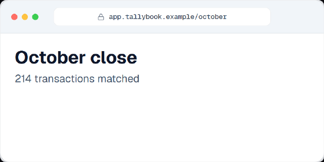
- Props: `theme`, `url`, `title`, `showAddressBar`, `actionsSlot`, `className`, `children`.
- Use for: any web app shown full-frame. Not for: phone UI (use DeviceMockupStage).
- Min size: 16:9 900x480, 9:16 940x700.
```tsx
<div className="frame-wrap min-h-0 flex-1">
  <BrowserFrame theme={theme} url="app.tallybook.example/october" title="Tallybook">
    <div className="px-10 pt-8 text-[40px] font-bold">October close</div>
  </BrowserFrame>
</div>
```

### AppShell
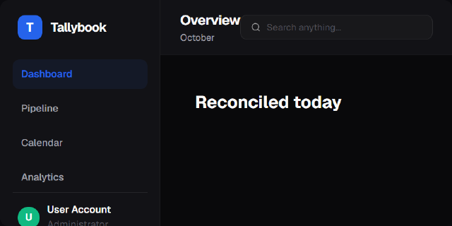
- Props: `theme`, `brandName`, `navItems[{id,label,active}]`, `headerTitle`, `headerSubtitle`, `headerActionsSlot`, `children`.
- Use for: dashboards with sidebar navigation. Not for: 9:16, or when the sidebar adds nothing.
- Min size: 16:9 1200x680 at zoom 1.2, 9:16 not recommended.
```tsx
<AppShell className="app-shell" theme={theme} brandName="Tallybook" headerTitle="Overview"
  navItems={[{ id: 'a', label: 'Reports', active: true }, { id: 'b', label: 'Clients' }]}>
  <MetricCardRow className="kpis" theme={theme} cards={cards} />
</AppShell>
```

### TerminalShell
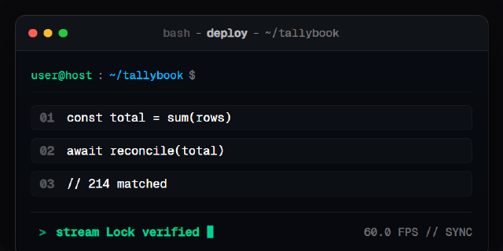
- Props: `title`, `path`, `width`, `height`, `children`. Always dark.
- Use for: CLI, deploy, build logs. Not for: light themes.
- Min size: 16:9 880x400, 9:16 940x520.
```tsx
<TerminalShell className="terminal" title="deploy" path="~/app">
  <CodeStreamBlock className="code" lines={lines} promptPath="~/app" />
</TerminalShell>
```

### PrecisionDashboardShell
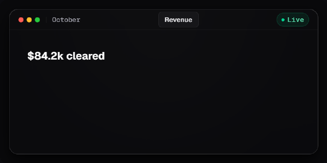
- Props: `title`, `subtitle`, `statusBadge`, `tiltX`, `tiltY`, `morphProgress`, `leftPane`, `rightPane`, `footerLeft`, `footerRight`, `width`, `height`.
- Use for: one dark slab that tilts or morphs between beats. Not for: light themes.
- Min size: 16:9 900x500, 9:16 940x640.

### DeviceMockupStage
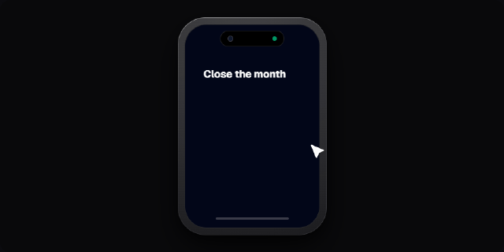
- Props: `deviceType` ('mobile' | 'desktop'), `title`, `width`, `height`, `tiltX`, `tiltY`, `children`.
- Use for: a phone or laptop bezel. Keep app text >= 18 px inside. Min size: mobile 16:9 340x600, 9:16 620x1100.

## Widgets (real anatomy inside a shell)

### MetricCardRow
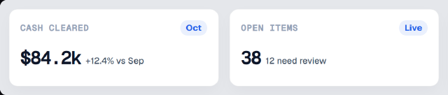
- Props: `cards[{id,title,badge,value,subtitle,stats}]` (3 columns fixed), `theme`.
- Use for: KPI summary. Not for: 9:16 (3 columns do not fit; use TelemetryTile).
- Min size: 16:9 1500x240 at zoom 1.5.
```tsx
<MetricCardRow className="kpis" theme={theme} cards={[
  { id: 'cash', title: 'Cash cleared', badge: 'Oct', value: '$84.2k', subtitle: '+12.4%' },
  { id: 'open', title: 'Open items', value: '38' }, { id: 'days', title: 'Days to close', value: '2.4' }]} />
```

### ChartCanvas
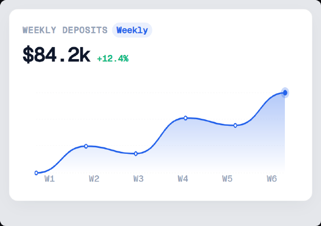
- Props: `data[{label,value}]`, `type` (area | line | bar), `title`, `badge`, `value`, `change`, `progress` (0..1), `height`, `theme`.
- Use for: the one hero chart. 5-7 points. Not for: dense multi-series data.
- Min size: 16:9 760x460 at zoom 1.5, 9:16 940x560.
```tsx
<div className="chart-wrap" style={{ zoom: 1.5 }}>
  <ChartCanvas theme={theme} title="Cash cleared" value="$84.2k" change="+12.4%" data={data} height={200} />
</div>
```

### DataTable
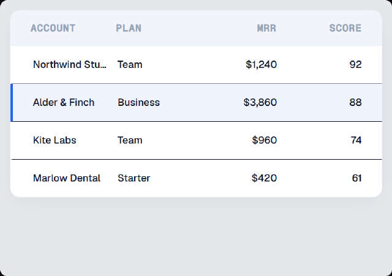
- Props: `columns[{key,label,align}]`, `rows[{id,...}]`, `highlightedRowIndex`, `renderCell`, `theme`.
- Use for: 3-5 rows with one highlighted row the camera lands on. Not for: more than 5 rows or 5 columns.
- Min size: 16:9 880x420 at zoom 1.4, 9:16 940x460 (max 3 columns).

### KanbanBoard
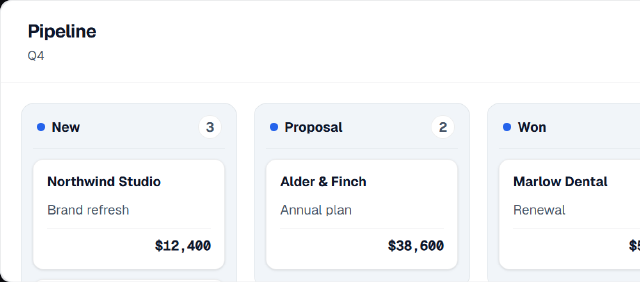
- Props: `boardTitle`, `boardSubtitle`, `headerStats`, `columns[{id,title,count,cards[{id,title,subtitle,amount,tags}]}]`, `theme`.
- Use for: pipeline or task flow, 3 columns x 1-2 cards. Not for: 9:16. Min size: 16:9 1300x560 at zoom 1.3.

### CalendarGrid
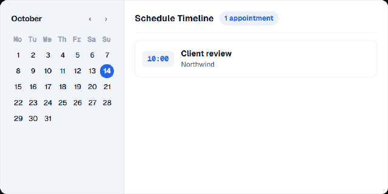
- Props: `monthTitle`, `selectedDay`, `events[{id,time,title,client}]`, `daysInMonth`, `theme`.
- Use for: booking or scheduling. Not for: 9:16. Min size: 16:9 880x440 at zoom 1.0 (text is 16-18 px native, zoom 1.2 preferred).

### ModalDialog
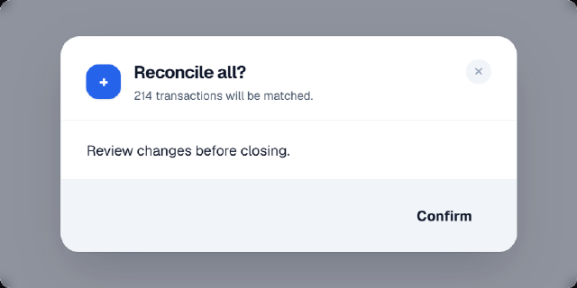
- Props: `title`, `subtitle`, `iconSlot`, `footerSlot`, `isOpen`, `width`, `children`. Put it over a dimmed app.
- Use for: confirm step after a click. Min size: 16:9 760x420, 9:16 900x520.

### SlideOverDrawer
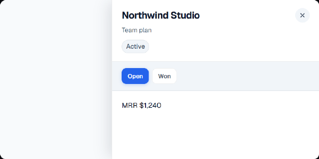
- Props: `title`, `subtitle`, `badges[{label,variant}]`, `statusOptions[{id,label,active}]`, `side`, `width`, `footerSlot`, `children`.
- Use for: detail panel after a row click. Min size: 16:9 880x440, 9:16 940x800.

## Atoms and molecules

### CapsulePill and KickerBadge
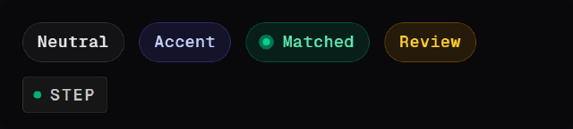
- `CapsulePill`: `label`, `tone` (neutral | accent | emerald | amber), `pulseDot`, `icon`. `KickerBadge`: `text`, `stepNumber`.
- Use for: status chips, section kickers. Not for: long text (max 2 words). Sizes: at zoom 1.4, 200x56.

### TelemetryTile
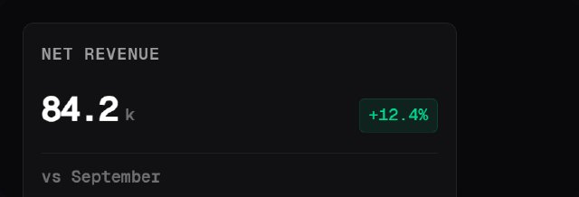
- Props: `title`, `value`, `unit`, `change`, `trend` (up | down | neutral), `footerNote`, `from`/`to`/`startFrame`/`endFrame` (count-up).
- Use for: one KPI, also in 9:16. Dark surface. Min size: 16:9 520x260, 9:16 700x300.

### CounterValue and AnimatedCounter
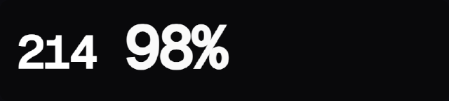
- `CounterValue`: `value`, `from`, `to`, `startFrame`, `endFrame`, `prefix`, `suffix`, `unit`. `AnimatedCounter`: `to`, `startAtSec`, `durationSec`, `decimals`, `prefix`, `suffix`, `deltaBadge`.
- Use for: a number that counts up. Give it font size from the parent (`text-[96px] font-black`).

### CodeStreamBlock
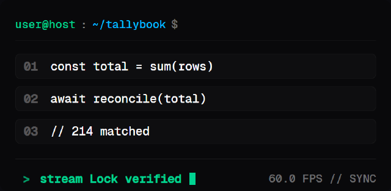
- Props: `lines[{number,tokens[{text,color}]}]`, `promptPath`, `startFrame`, `lineStaggerFrames`, `cursorBlink`.
- Use for: code or command output inside TerminalShell. Max 6 lines. Min size: 16:9 800x340, 9:16 940x420.

### HairlineGrid, ProceduralWaveform
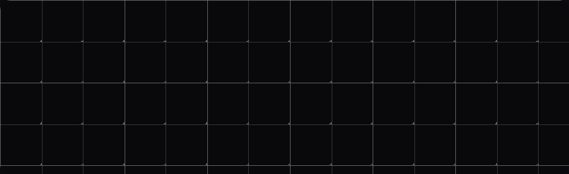
- `HairlineGrid`: `spacing` (multiple of 8), `opacity`, `showCrosses`; place `absolute inset-0` behind content. `ProceduralWaveform`: `barCount`, `height`, `frame`, `color` (Tailwind bg class).
- Use for: depth layer 1 and voice or music scenes.

### SimulatedCursor, VerifiedCursor
- `SimulatedCursor`: `color`, `rippleColor`, `label`; targets `.simulated-cursor` and `.cursor-ripple`; move with `arcMove`, click with `emphasize(... 'punch')`.
```tsx
<div className="relative"><div className="reconcile-btn">Reconcile all</div><SimulatedCursor color={colors.textPrimary} /></div>
```

## Type and surfaces

### KineticHeadline
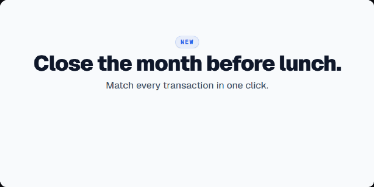
- Props: `tag`, `title`, `subtitle`, `size` ('md' | 'xl'; use xl: 72px title, 32px subtitle), `headlineClassName`, `theme`. Positioned absolute at the top.
- Use for: opening headline block. Not for: more than 8 words per line.

### KineticText, KineticBurstWord
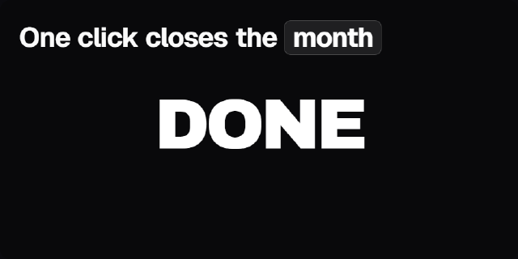
- `KineticText`: `text`, `wordClassName` (the timeline target), `variant` (hero | dialogue | title | subtitle), `highlights` ({word: 'pill'}). `KineticBurstWord`: `text`, `letterClassName`, `className` (set size).
- Use for: word-by-word statements; one short brand word. Dark surfaces (text is near white).
```tsx
<KineticText text="One click closes the month" wordClassName="stmt-word" variant="title" highlights={{ month: 'pill' }} />
// tl: enter(tl, '.stmt-word', 'words', 0.3)
```

### SpecularCard
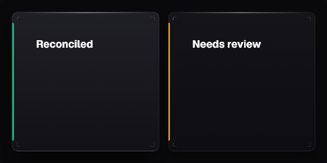
- Props: `accent` (neutral | emerald | red | amber | white), `tone` (active | muted), `cornerTicks`, `cardClassName`, `children`.
- Use for: dark status cards. Not for: light themes.

### SpotlightStage
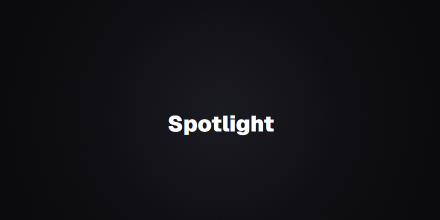
- Props: `aspect`, `theme`, `clean` (no HUD), `hudTagLeft`/`Right`, `children`. Use for: centred dark hero scene with a vignette.

### BackdropField
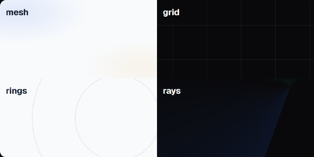
- Props: `theme`, `variant` (mesh | grid | rings | rays), `intensity` (0.4-0.8), `className`.
- Use for: depth layer 1 under every scene; drift it with `camera(tl, '.backdrop', 'drift', ...)`.

## Depth, camera, continuity (no thumbnail; structural)

| Export | Props worth knowing | Use for |
|---|---|---|
| `LayeredStage3D`, `LayerPlane` | `rotateX/Y/Z`, `perspective`, `scale`; plane `z`, `specularRim`, `elevationShadow` | stacked planes with real depth (thumbnail `gallery/LayeredStage3D.png`) |
| `CameraRig` | `rigClassName` | wrapper a timeline pushes, pans or rolls |
| `SpatialCamera`, `VirtualCanvas` | camera slots, cursor slot | UI camera that keeps the cursor aligned |
| `TheHeroActor`, `ContainerMorphBridge`, `SceneSlot` | `id`, `className`, `style` | one object that lives frame 0 to end |
| `SvgFilterLab`, `GooeyMorphGroup`, `SpeechBubbleTailSVG` | `idPrefix`, `filterId`, `variant` | gooey blobs, chat bubbles |
| `HarvestVoiceOver`, `HarvestKineticSubtitles`, `HarvestBRollBackground` | harvested EdgeTTS assets | voice-over, subtitles, b-roll |

## Not curated
Graded ARCHIVE (tiny type, baked palettes, glow, broken in use, or no users): `InteractiveMap`, `LoupeMagnifier`, `BroadcastPackageStrap`,
`LedgerCardStage`, `TechnicalDraftingStage`, and the Tactile, MobileSting, Papercraft, Equalizer, Deconstructive, Sculptural, InteractivePromo,
EditorialSpecimen and KineticVector families, plus `ContainerMorph`, `VectorDraw`, `TemplateFrame`, `RoughCanvas`, `ChalkboardStage`, `CutoutPuppetStage`.
