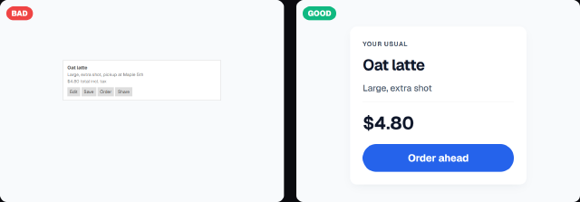
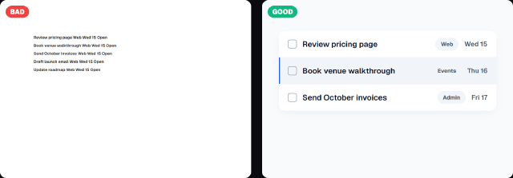
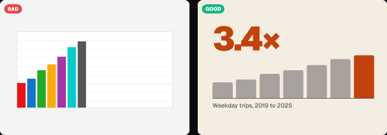
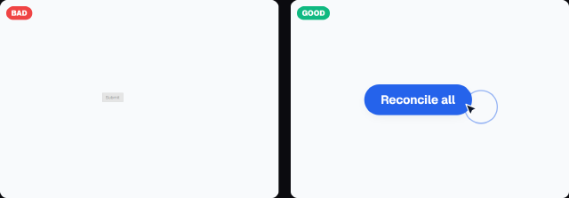
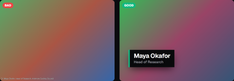
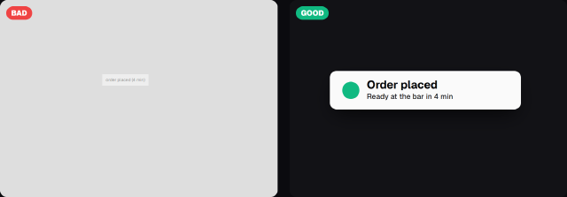
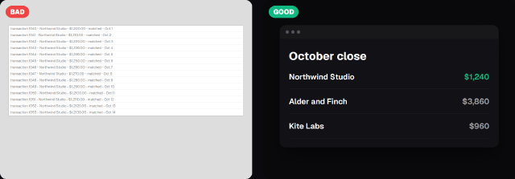

# Component recipes (how to design the piece, not just which primitive)

Mid-size models make components that are small, flat and cramped. These recipes give numbers (px on the FINAL frame, tokens from `src/core/tokens.ts`), a hierarchy rule, a snippet and the motion order for nine common pieces. Each has a BAD/GOOD thumbnail pair in `docs/gallery/recipes/`.
Real working code: `src/projects/example-editorial-data`, `example-social-promo`, `example-feature-tour` (their `components/` folders). Numbers: `docs/DESIGN_SYSTEM.md`; primitives: `docs/COMPONENT_GALLERY.md`; motion: `docs/PRESETS.md`.

## Rules for every recipe
- **Components are presentational** (`components/*.tsx`: max 6 files, each at most 120 lines, no motion, no raw colors: take `theme` as a prop, text 18 px or larger, root forwards `className`). All animation lives in `Scene.tsx` `buildTimeline`, selecting classNames the components render.
- **Hierarchy:** one primary element per frame (largest, highest contrast, the only accent fill). Max 3 type sizes per frame, max 2 accents, secondary text `textMuted` (7:1 or better), never `textGhost` for words.
- **Size steps are big:** adjacent type roles differ by at least 1.4x (72 -> 48 -> 28 -> 20). Spacing only from `SPACE` (8, 16, 24, 32, 48, 64, 96, 128).
- **Padding:** cards 32 (16:9) / 40 (9:16); gaps between cards 24 / 32; button 20x40 / 24x48; pill 8x20 / 10x24 (`SURFACE_PADDING`).
- **Radii:** `RADII.sm` 8 chips and inputs, `md` 14 cards inside shells, `lg` 22 standalone cards and modals, `pill` buttons.
- **Shadows:** `SHADOWS.<mode>.e1/e2/e3` only; black or slate, never colored.
- **Empty space is design:** content fills at most 60% of its panel; if it feels cramped, remove an element before shrinking text.
- Motion defaults: enter with `.out` eases (presets do this), one cause then one effect, 2-6 f offsets between parts, the click is the cause.

## 1. UI card

- Anatomy: padding `SPACE.s5` 40 (9:16) / 32; kicker `label` 20-22; title `title` 48 (56 in 9:16); detail `body` 28 `textMuted`; hairline `borderSubtle`; price 56 bold; ONE button, height 88-96, `RADII.pill`.
- Size: 16:9 card 560-640 x 480-560; 9:16 card 580-860 wide, never narrower than 55% of the frame width.
- Contrast: title `textPrimary` on `bgSurface` 14:1+; button label on accent 4.5:1+ (use `bgPrimary` on orange/yellow, white on blue only at 24 px bold).
```tsx
export const OrderCard: FC<OrderCardProps> = ({ theme, title, detail, price, action, className = '' }) => (
  <div className={`flex w-[580px] flex-col gap-8 p-10 ${className}`}
    style={{ backgroundColor: theme.colors.bgSurface, borderRadius: RADII.lg, boxShadow: SHADOWS.dark.e3 }}>
    <div className="text-[48px] font-bold leading-[1.15]">{title}</div>
    <div className="text-[28px]" style={{ color: theme.colors.textMuted }}>{detail}</div>
    <div className="text-[56px] font-bold">{price}</div>
    <div className="order-btn flex h-[96px] items-center justify-center text-[32px] font-bold"
      style={{ backgroundColor: theme.colors.accentSecondary, color: theme.colors.bgPrimary, borderRadius: RADII.pill }}>{action}</div>
  </div>
);
```
- Motion: card `enter 'blurIn'` (or `rise`), then children are static; if the card is the focal, `camera 'pushIn' soft` 0.5 s before the click.

## 2. List / rows

- Anatomy: row height 84-96 (never under 72), padding x 32, gap 20; checkbox 32 (`RADII.sm`); title `body` 28 semibold; tag chip 20 bold (pill 8x20, `bgSurfaceSubtle`); meta 24 `textMuted`; 1 px hairline between rows, no zebra.
- Show 3-5 rows, never 8+. Exactly one row is highlighted (accent left bar 4 px or `bgSurfaceSubtle`).
- Hierarchy: title is the only `textPrimary` text in the row; chips and meta are quieter.
- Snippet: `TaskRow` in `example-feature-tour/components/TaskRow.tsx` (title flex-1, tag chip, due chip with a second `due-set` chip stacked on it).
- Motion: `enter 'stagger'` (tight) for the rows; a new row: shift the rows below with one `y` tween (`DURATIONS.panel`, `expoOut`) and `rise` the new row 0.05 s later.

## 3. Data chart / stat

- Anatomy: ONE hero number (`display` 112 or a 160-400 px numeral, `accentPrimary`), a label `title` 48 or `body` 28, 5-7 bars. Bars: neutral tone (`textGhost`), the story bar in the accent; value above each bar 28 bold, year below 28; baseline 2 px `textPrimary`; no gridlines, no legend, no rainbow.
- Size: 16:9 chart 1680 x 460 (7 columns of 240, bars 128 wide, tallest 330); 9:16 chart 940 x 560, 5 bars of 140.
- Hierarchy: number 1 -> accent bar 2 -> everything else muted. One annotation line at most (dashed 2 px).
- Snippet: `BarChart` in `example-editorial-data/components/BarChart.tsx`.
- Motion: numeral `blurIn`, then it moves to the header with ONE `x/y/scale` tween (0.8 s `expoInOut`, keep it mounted); baseline `wipe`, years `stagger`, bars `fromTo scaleY 0 -> 1` with `transformOrigin 50% 100%`, stagger `TIMING.layerStagger`, values `stagger` 0.25 s later; last bar `punch`.

## 4. Button + click

- Anatomy: pill, padding 24x48 (9:16) / 20x40, label `body` 28-40 bold, `RADII.pill` or `md`, accent fill, no outline. Cursor 28 px drawn at scale 1.4-1.5 (`SimulatedCursor`), ripple 44 px.
- Size: button at least 72 px high on the final frame; it is the focal of its beat, so it sits in its storyboard zone.
- Hierarchy: the button is the only accent fill in the card; secondary actions are text or outlines.
- Motion order (cause then effect): cursor glides in (`DURATIONS.long`, `sineInOut`, under 30 px/f), ripple + `emphasize 'punch'` on the button at the arrival frame, THEN the result (toast, new row, panel) 0.15-0.25 s later. Never show the result before the click.

## 5. CTA end card

- Anatomy (16:9 1920x1080): accent canvas, mark 112-128 (`RADII.xl`), headline `display` 96-112 two lines max, pill button `title` 36-44 on `bgSurface`, gaps `SPACE.s5/s6` (48/64). 9:16: headline 84-120, button 40-44 px label inside y 1490-1620.
- Contrast: white on `accentPrimary` is 4.5:1+ only for the light theme blue; on a darker canvas use `bgPrimary` text on a bright pill. Check `docs/DESIGN_SYSTEM.md` section 4.
- Hierarchy: headline 1, button 2, mark 3; no fine print (no 14-16 px lines).
- Motion: mark `pop`, headline `words`, button `rise` 0.3 s after the last word; one `punch` on the button itself (glint is a moving overlay preset: do not use it on a decorative overlay or on the button); all done by `holdFinal` start, then 1.2 s still.

## 6. Kinetic headline block

- Anatomy: kicker (`label` 20-22, uppercase, accent rule 4 x 64) over 2-3 lines of `display` 112-128, tracking -0.04em, line-height 1.0-1.04; ONE word in the accent. Max 5 words per line at 16:9, 3 at 9:16, 3-7 words total.
- Never a paragraph. A sentence of 10+ words is a caption (`body`), not a headline.
- Snippet: `Headline` in `example-social-promo/components/Headline.tsx` (one `headline-word` span per word).
- Motion: `enter(tl, '.headline-word', 'words', at)` (0.38 s + 0.06 s per word); hold 0.3-0.5 s before the next beat; accent word gets `punch` only if it is the point.

## 7. Lower-third / caption

- Anatomy: plate (`bgPrimary`, `SHADOWS.dark.e3`) with a 10 px accent edge; name `title` 48 bold, role `body` 28 `textMuted`; padding 32 x 20-24. Inside the safe zone: 16:9 left margin 120/bottom 110-160, 9:16 bottom edge above y 1620.
- Never text straight on video; always a plate or a scrim (`rgba(0,0,0,0.55)` hairline-safe in components) so contrast stays 7:1+.
- Captions (voice-over): `body` 36 (9:16) / 28, max 2 lines, 6-7 words per line.
- Motion: plate `wipe` (0.5 s), text `rise` 0.1 s later, exit `sink` 0.32 s; 2.5-4 s on screen.

## 8. Notification / toast

- Anatomy: width 460-620, padding 24 x 40, `RADII.md/lg`, status dot or check 20-56 (status color only for real status), title `title` 28-36 bold, detail 20-24. INVERTED surface (light on a dark scene, dark on a light one) so it outranks the card behind it; `SHADOWS.<mode>.e3`.
- Place it below or beside the thing that caused it, 24-48 px away, never over the cause.
- Snippet: `Toast` in `example-social-promo/components/Toast.tsx`.
- Motion: `enter 'pop'` 0.2 s after the click, stays at least 1.2 s (reading), exit `sink`; the character or camera reacts 2-6 f after the pop.

## 9. App window at broadcast scale

- Rule: every UI text on the final frame is 18 px or larger. Build the window directly at final size (1440 x 800 at 16:9: title bar 56, sidebar 240, rows 84, text 24-28) or use a shell primitive wrapped as in `example-product-ui`: the shell gets `zoom: UI_SCALE.recommendedZoom[0]` (1.2) and the content inside gets `zoom: 1 / UI_SCALE.recommendedZoom[0]`, then its own larger zoom if it is a widget.
- Show 3-5 rows or one chart, never a full desktop. Dim or hide the rest with the camera, not by shrinking type.
- Camera: wrapper `.cam` (`transformOrigin 50% 50%`), `x/y/scale` tweens of 1.0-1.2 s with `sineInOut` (peak 1.6x) so speed stays under 30 px/f; scale 1.6 for the feature, 1.0 for the recap. Keep the zoomed view edge in a gap between texts (probe P007 warns about text cut by the frame edge).
- Snippet: `AppWindow` in `example-feature-tour/components/AppWindow.tsx`.
- Motion: window `blurIn`, camera moves, then each feature as cause (cursor click + ripple) then effect (row slides, chip fills, avatars pop, toast).

## Checklist before `pnpm check`
Largest element is the one you want looked at? One accent fill? No text under 20 px (18 absolute)? Spacing only from SPACE? Cards have 32-40 px padding and a hairline or e2/e3 shadow, never a hard border plus shadow? Rows at least 84 px? Does the result appear after its cause?
