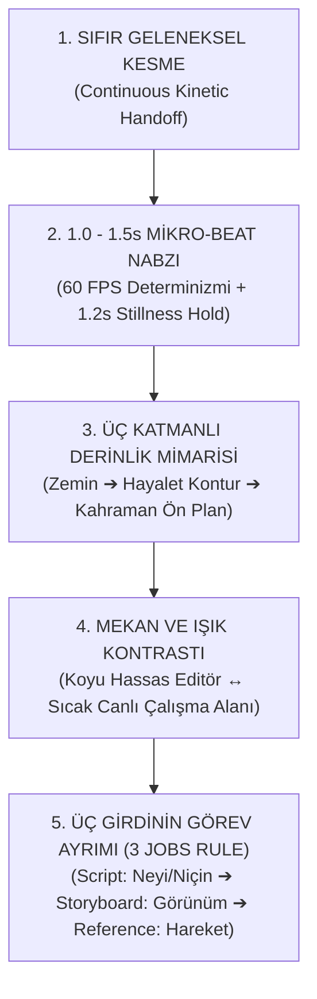

# MASTER STORYBOARD & HAREKET KURGU ANAYASASI (THE 5 UNIVERSAL LAWS)
> **Kapsam:** Motion Lab stüdyosundaki tüm projelerde (`src/projects/<slug>/`) storyboard, beat tablosu (`spec.json`) ve konsept tasarımı (`direction.md`) oluşturulurken uyulması ZORUNLU olan 5 Evrensel Yasa ve Prodüksiyon Standartları.
> **Referans:** 10 Master Saha Kılavuzu (Field Guides 01–10) Sentezi (`master_storyboard_synthesis_report.md`).

---

## 1. BEŞ EVRENSEL STORYBOARD YASASI (THE 5 UNIVERSAL LAWS)



### Yasa 1: Sıfır Geleneksel Kesme & Kesintisiz Kinetik Devir Teslim (Kinetic Handoff)
- **Kural:** Hiçbir storyboard'da bir sahnenin ekran kararmasıyla (crossfade dissolve) bitip yeni sahnenin sıfırdan belirmesi (PowerPoint slayt mantığı) kesinlikle YASAKTIR.
- **Uygulama:** 
  - Sahneyi baştan sona taşıyan bir **Ana Geometrik Aktör (`TheHeroActor`)** veya **Tek Yaşayan Kap (`SingleContainer`)** belirlenir.
  - Bu aktör videonun 0. karesinden son karesine kadar fiziksel olarak sahnede kalır (`opacity > 0`).
  - Beat geçişlerinde aktör form değiştirir (Daire $\rightarrow$ 45° Çizgi $\rightarrow$ Bar Sütunu $\rightarrow$ Kadran Yayı $\rightarrow$ İsviçre Haçı $\rightarrow$ Kart Gövdesi).
  - İzleyicinin gözü aktörü takip ettiği için sahneler arası geçişte yön kaybı ve bilişsel kopukluk sıfırlanır.

### Yasa 2: 1.0 – 1.5 Saniyelik Mikro-Beat Nabzı & 1.2s Kapanış Kuralı
- **Kural:** Video asla monoton bir şekilde akamaz; izleyicinin dikkat eşiği her 60–90 karede bir (1.0–1.5 saniye) yeni bir görsel/fiziksel impuls ile tetiklenmelidir.
- **Uygulama:**
  - **Gelişme Nabzı:** Her 60–90 karede kamera açısı, nesne formu, z-derinliği veya odak noktası evrilir. Monoton eşit süreler yasaktır ($\sigma(\text{durations}) \ge 14\text{ kare}$).
  - **1.2s Nihai Duraklama (Stillness Hold):** Kapanıştaki ana mesaj, logo ve eyleme çağrı (CTA) ekranda **en az 1.2 saniye (72 kare @ 60 FPS)** net, flu olmayan şekilde sabit kalmalıdır. İnsan beyninin mesaja inanması ve harekete geçmesi bu duraklamaya bağlıdır.
  - **Kinetik Punch:** Ritmik ara kelimeler sahne akışını dondurmayacak şekilde 8–25 karelik patlamalarla girip çıkabilir.

### Yasa 3: Üç Katmanlı Derinlik Mimarisi (3-Layer Depth System)
- **Kural:** Sahneler düz ve basık 2D olamaz; ağır WebGL motorları yerine saf CSS 3D (`perspective: 1400px`, `transformStyle: 'preserve-3d'`, `translateZ`) ve SVG katmanlaması kullanılır.
- **3 Katman:**
  1. **Katman 1 - Arka Plan (Atmospheric Base):** Koyu mat zemin (`#050706` / `#07090e`), difüze radyal degrade (`RadialGlow`), 1px kılcal kılavuz ızgarası (`subgrid gap-1px`) veya zemin ışığı çizgisi (`IlluminatedFloorSurface`).
  2. **Katman 2 - İkincil Derinlik & İz (Secondary Ghost / Shadow Layer):** Ön plandaki nesnenin arkasından 2–4 piksel ofsetle ve 2–3 kare gecikmeyle (`trailing lag`) gelen hayalet konturlar, yumuşak temas gölgeleri (`ambient-shadow`) veya yankılanan dalga formları.
  3. **Katman 3 - Kahraman Ön Plan (Foreground Hero):** Kristal netliğinde tipografi, 1px pahlı fasetli kenar yansıması (`specularRimTop`), altın/nane vurgulu katı elemanlar ve canlı interaktif HUD rozetleri.

### Yasa 4: Mekan & Işık Kontrastı (Atmospheric Contrast)
- **Kural:** Video boyunca tek tip donuk bir aydınlatma sürdürülemez.
- **Uygulama:**
  - Özellikle dijital ürün, SaaS ve uygulama hikayelerinde: **Koyu Hassas Editör (Dark Precision Editor)** ile **Sıcak/Aydınlık Yaşam Alanı (Warm Inviting Workspace)** arasında bilinçli bir tempo kurgulanır.
  - Kodlama, veri analizi veya mikro-işlemler koyu, odaklanmış ekranda geçerken; kullanıcı deneyimi, sonuç ve iş birliği aşamasında sahne aydınlık, organik ve sıcak tonlara geçiş yapar.

### Yasa 5: Üç Girdinin Görev Ayrımı (The 3-Input Rule)
- **Kural:** Bir video fikri doğrudan kod veya tek bir devasa prompt olarak tasarlanamaz. Her sahne 3 temel girdiyle ayrıştırılır:
  1. **Script (Senaryo):** *Neyi* ve *Niçin* anlatıyoruz? (Mesaj hiyerarşisi, pazarlama vaadi, problem ve çözüm).
  2. **Storyboard (Görsel Kurgu):** Sahne *Nasıl görünüyor?* (Kamera açısı, ışık kaynağı, renk paleti, 3 katmanlı derinlik kompozisyonu, donanım penceresi).
  3. **Motion Reference (Hareket Referansı):** Nesneler *Nasıl hareket ediyor?* (Yay katsayıları, kavisli Bézier yolları, atalet sönümlenmesi, FLIP ölçeklemesi).

---

## 2. STANDART 5 AŞAMALI HİKAYE HUNİSİ (STORYBOARD FUNNEL)

Her 15–30 saniyelik storyboard şu 5 aşamalı akışı takip etmelidir:

```
[01. KANCA (Hook)] ➔ [02. TANITIM (Introduce)] ➔ [03. KANIT (Demonstrate)] ➔ [04. GETİRİ (Payoff)] ➔ [05. ÇAĞRI (CTA/Resolve)]
```

| Aşama | Süre / Frame | Amaç | Görsel Dil | Hero Aktör Durumu |
|---|---|---|---|---|
| **01. Kanca (Hook)** | 0–2.0s (0–120f) | Merak uyandır, sorunu göster | Minimal, yüksek kontrast, mikro ses dalgası | Kompakt tek amblem / dar kapsayıcı |
| **02. Tanıtım (Introduce)** | 2.0–5.0s (120–300f) | Kahramanı sahneye oturt | Hardware Shell / Precision Window içine kilitlenme | Kapsayıcı genişler, pencere formuna evrilir |
| **03. Kanıt (Demonstrate)** | 5.0–12.0s (300–720f) | Özelliği canlı işlet (mikro-eylem) | Canlı klavye yazımı, kavisli imleç tıklaması, telemetri akışı | Pencere içi alt paneller açılır (`Subgrid 1px`) |
| **04. Getiri (Payoff)** | 12.0–16.0s (720–960f) | Başarı anı ve dönüşüm | Mekan değişimi: Koyu editörden sıcak çalışma alanına sıçrama | Panel küçülür, başarı rozetine/halkaya dönüşür |
| **05. Çağrı (CTA / Outro)** | 16.0–20.0s (960–1200f) | Mesajı beyne kazı (Stillness Hold) | Büyük logo, berrak tipografi, 1.2s+ sabit duruş | Hero aktör son marka amblemine kilitlenir |

---

## 3. ZORUNLU STORYBOARD ZAMAN TABLOSU ŞABLONU (BEAT SPEC)

`src/projects/<slug>/direction.md` ve `spec.json` içinde her beat şu 7 sütunlu mimariye sadık kalmalıdır:

```markdown
| Beat | Zaman & Kare | 3 Katmanlı Derinlik | Hero Aktör Formu & Dönüşüm | Canlı Mikro-Aksiyon | Kamera Intent & Rig | Sınır Geçişi & SFX |
| :--- | :--- | :--- | :--- | :--- | :--- | :--- |
| **B1: Kanca** | 0.0–1.5s (0–90f) | Zemin: Obsidyen + 1px Grid<br>İkincil: Hayalet Kontur (2f lag)<br>Ön Plan: Nane Yeşil Solid Type | Dairesel Monogram (120px) | Kelime patlaması (0.06s stagger) + 5-bar ses dalgası | Push-In: scale 1.0->1.18, rotX 2° | Whip-Pan + Bas Vuruş SFX |
| **B2: Giriş** | 1.5–3.5s (90–210f) | Zemin: Difüze Radial Glow<br>İkincil: Ambient Shadow<br>Ön Plan: macOS Hardware Shell | Monogram -> Pencere Başlığına Morphing | Canlı stylus write-on / klavye yazımı | Follow-Pan: y -20px, rotX 0° | Container Morph + Klavye Tık SFX |
| **B3: Kanıt** | 3.5–6.0s (210–360f) | Zemin: 1px Subgrid Matrix<br>İkincil: Gecikmeli Telemetri İzi<br>Ön Plan: Kristal Metrik Kart | Pencere İçi 1px Grid Matrisi | Canlı sayaç + sparkline çizimi | Macro-Lock: Sabit rock-steady | Diagonal Sweep + Speküler Pırıltı SFX |
| **B4: Getiri** | 6.0–8.0s (360–480f) | Zemin: Sıcak Çalışma Alanı Gradyanı<br>İkincil: Soft Ambient Shadow<br>Ön Plan: Altın Pahlı Amblem | Grid -> 45° Pahlı Yüzük | Rozet genişlemesi + fasetli ışık süpürmesi | Pull-Out: scale 1.15->1.0 | Mask Wipe + Işıltı SFX |
| **B5: Kapanış** | 8.0–10.0s (480–600f) | Zemin: Derin Marka Zemini<br>İkincil: Hafif z-10 Parıltı<br>Ön Plan: 72px Logo + CTA | Yüzük -> Marka Amblemine Kilit | **STILLNESS HOLD (>= 1.2s)** Sabit berrak duruş | Sabit kamera (Zero Drift) | Hero Resolve + Reverb Kuyruk SFX |
```

---

## 4. KALİTE DENETİM VE KONTROL KAPISI (QUALITY GATE)

Kodlama başlamadan önce storyboard şu sorularla denetlenir:
1. `TheHeroActor` tanımlandı mı? Videonun 0. karesinden son karesine kadar fiziksel olarak sahnede mi?
2. Beat süreleri 1.0–1.5s aralığında mı? (Monotonluk var mı?)
3. Kapanış beat'i en az 1.2s (72 kare) duraklama içeriyor mu?
4. 3 Katmanlı derinlik (Zemin, Hayalet Kontur, Ön Plan) tanımlandı mı?
5. Sahneler arası geçişte sahte opacity crossfade yasaklandı mı?
6. Her kamera hareketinin motive edici bir gerekçesi (`intent`) var mı?
