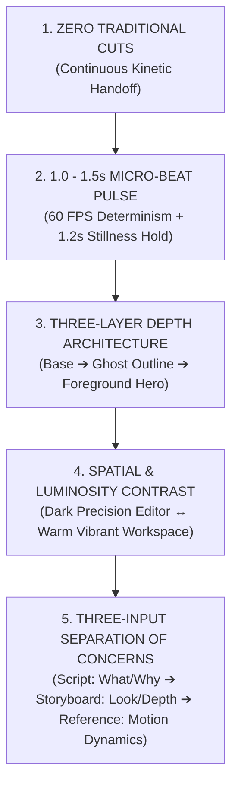

# MASTER STORYBOARD & MOTION EDITORIAL CONSTITUTION (THE 5 UNIVERSAL LAWS)
> **Scope:** Mandatory production standards and 5 Universal Laws governing storyboard creation, beat timing tables (`spec.json`), and creative concept specifications (`direction.md`) across all projects (`src/projects/<slug>/`) in the Motion Lab studio.
> **Reference:** Synthesis of 10 Master Field Guides (Field Guides 01–10).

---

## 1. THE FIVE UNIVERSAL STORYBOARD LAWS



### Law 1: Zero Traditional Cuts & Continuous Kinetic Handoff
- **Rule:** Storyboards must never end a scene with a crossfade dissolve or slide-deck transition where the screen dims to black and rebuilds from scratch.
- **Implementation:** 
  - Establish a primary geometric actor (`TheHeroActor`) or **Continuity Anchor** that carries narrative momentum throughout the entire video.
  - The hero actor remains physically present on stage from frame 0 to the final frame (`opacity > 0`).
  - **SaaS Container Dogma Forbidden:** Continuous container does NOT mean centering a static 1380px dark box with 4 nested telemetry tiles. The actor can explode into a full-bleed video scene (Theatre Mode Takeover), morph from a search pill into a responsive player, or lock into a monumental brand emblem.
  - At beat boundaries, the actor changes geometry or scale (Search Pill $\rightarrow$ 16:9 Video Player $\rightarrow$ Fullscreen Cinema $\rightarrow$ Brand Emblem).
  - Tracking the actor eliminates cognitive disorientation and maintains visual flow across scene boundaries.

### Law 2: 1.0 – 1.5 Second Micro-Beat Pulse & 1.2s Stillness Hold Rule
- **Rule:** Pacing must never stagnate; the viewer's attention threshold must be stimulated every 60–90 frames (1.0–1.5 seconds) with a deliberate visual or physical impulse.
- **Implementation:**
  - **Progression Pulse:** Every 60–90 frames, evolve camera perspective, object form, Z-depth, or visual focal point. Equal, monotonous beat durations are strictly forbidden ($\sigma(\text{durations}) \ge 14\text{ frames}$).
  - **1.2s Final Stillness Hold:** The closing key takeaway, brand logo resolve, and call-to-action (CTA) must remain rock-steady and crisp on screen for **at least 1.2 seconds (72 frames @ 60 FPS)**. Trust and viewer action depend on this stillness.
  - **Kinetic Punch:** Rhythmic interstitial words may punch and exit in 8–25 frame bursts without halting narrative momentum.

### Law 3: Three-Layer Depth Architecture (3-Layer Depth System)
- **Rule:** Compositions must never feel flat or cardboard-like. Rather than heavy WebGL runtimes, leverage pure CSS 3D (`perspective: 1400px`, `transformStyle: 'preserve-3d'`, `translateZ`) and SVG layering.
- **The Three Layers:**
  1. **Layer 1 - Background Base (Atmospheric Base):** Brand-authentic pure white/light canvas (`#FFFFFF` / `#F9F9F9`, Google/YouTube), vibrant brand backdrop, or matte dark slate (`#050706`), diffuse radial glow (`RadialGlow`), 1px hairline guide grid (`subgrid gap-1px`), or illuminated ground line (`IlluminatedFloorSurface`).
  2. **Layer 2 - Secondary Depth & Trailing Ghost (Ghost / Shadow Layer):** Secondary outlines trailing 2–4 pixels behind foreground objects with 2–3 frames of lag (`trailing lag`), soft ambient contact shadows (`ambient-shadow`), secondary video interface panes, or undulating waveform trails.
  3. **Layer 3 - Foreground Hero (Foreground Hero):** Razor-sharp typography, authentic product UI (search pill, player controls, subscribe button), 1px beveled rim specular highlights (`specularRimTop`), and solid brand-accented focal components.

### Law 4: Spatial, Luminosity & Scale Contrast (Atmospheric & Scale Contrast)
- **Rule:** A scene cannot maintain monotonous lighting, fixed bounding boxes, or uniform camera distance throughout its lifecycle.
- **Implementation:**
  - **Luminosity Contrast:** Intentionally sequence transitions between focused dark editing environments and bright, vibrant brand canvases.
  - **Scale Explosion (Dynamic Scale Contrast):** Transition dramatically from micro-interactions (e.g., an icon click or typing input) to full-viewport theatre mode (20x scale jump), giving the animation genuine motion design velocity.

### Law 5: Three-Input Separation of Concerns (The 3-Input Rule)
- **Rule:** A motion project cannot be conceptualized directly as code or a single bloated prompt. Every scene must be planned across three distinct inputs:
  1. **Script:** *What* and *Why* are we communicating? (Message hierarchy, marketing claim, friction and resolution).
  2. **Storyboard:** *How does it look?* (Camera framing, lighting vectors, color system, 3-layer depth hierarchy, authentic UI anatomy).
  3. **Motion Reference:** *How does it move?* (Spring tension/damping, curved Bézier trajectories, momentum transfer, FLIP morphing).

---

## 2. STANDARD 5-STAGE STORYBOARD FUNNEL

Every 15–30 second motion storyboard follows this 5-stage progression:

```
[01. HOOK] ➔ [02. INTRODUCE] ➔ [03. DEMONSTRATE] ➔ [04. PAYOFF] ➔ [05. RESOLVE / CTA]
```

| Stage | Duration / Frames | Objective | Visual Language | Hero Actor State |
|---|---|---|---|---|
| **01. Hook** | 0–2.0s (0–120f) | Spark curiosity, surface friction | Minimalist, high contrast, micro soundwave | Compact emblem / constrained container |
| **02. Introduce** | 2.0–5.0s (120–300f) | Ground the hero element | Locks into Hardware Shell / Authentic Window | Container expands and morphs into window form |
| **03. Demonstrate** | 5.0–12.0s (300–720f) | Live feature execution (micro-action) | Live keyboard typing, curved cursor click, telemetry feed | Internal subgrids unlock (`Subgrid 1px`) |
| **04. Payoff** | 12.0–16.0s (720–960f) | Value realized & transformation | Environmental shift: Dark editor to warm workspace | Container contracts into beveled achievement badge |
| **05. Resolve (CTA)** | 16.0–20.0s (960–1200f) | Anchor core message (Stillness Hold) | Prominent logo, pristine typography, 1.2s+ static hold | Hero actor locks into final brand emblem |

---

## 3. MANDATORY STORYBOARD TIMELINE SPECIFICATION (BEAT SPEC)

In `src/projects/<slug>/direction.md` and `spec.json`, each beat must adhere to this 7-column schema:

```markdown
| Beat | Time & Frame Range | 3-Layer Depth | Hero Actor State & Morph | Live Micro-Action | Camera Intent & Rig | Boundary Transition & SFX |
| :--- | :--- | :--- | :--- | :--- | :--- | :--- |
| **B1: Hook** | 0.0–1.5s (0–90f) | Base: Obsidian + 1px Grid<br>Secondary: Ghost Outline (2f lag)<br>Hero: Mint Solid Type | Circular Monogram (120px) | Word burst (0.06s stagger) + 5-bar soundwave | Push-In: scale 1.0->1.18, rotX 2° | Whip-Pan + Bass Punch SFX |
| **B2: Intro** | 1.5–3.5s (90–210f) | Base: Diffuse Radial Glow<br>Secondary: Ambient Shadow<br>Hero: macOS Hardware Shell | Monogram -> Window Title Morph | Stylus write-on / keyboard typing | Follow-Pan: y -20px, rotX 0° | Container Morph + Click SFX |
| **B3: Demo** | 3.5–6.0s (210–360f) | Base: 1px Subgrid Matrix<br>Secondary: Trailing Telemetry Trace<br>Hero: Crystalline Metric Card | Window Internal 1px Matrix | Live counter + sparkline write-on | Macro-Lock: Rock-steady hold | Diagonal Sweep + Specular Glint SFX |
| **B4: Payoff** | 6.0–8.0s (360–480f) | Base: Warm Workspace Gradient<br>Secondary: Soft Ambient Shadow<br>Hero: Gold Beveled Emblem | Subgrid -> 45° Beveled Ring | Badge expand + faceted specular sweep | Pull-Out: scale 1.15->1.0 | Mask Wipe + Shimmer SFX |
| **B5: Resolve** | 8.0–10.0s (480–600f) | Base: Deep Brand Ground<br>Secondary: Subtle z-10 Rim Glow<br>Hero: 72px Brand Mark + CTA | Ring -> Lock into Brand Mark | **STILLNESS HOLD (>= 1.2s)** Crisp static hold | Fixed camera (Zero Drift) | Hero Resolve + Reverb Tail SFX |
```

---

## 4. PRE-FLIGHT STORYBOARD QUALITY AUDIT

Before writing code, verify the storyboard against these criteria:
1. Is `TheHeroActor` identified and physically present from frame 0 through the final frame?
2. Are beat durations within the 1.0–1.5s range with dynamic variation ($\sigma \ge 14\text{ frames}$)?
3. Does the final closing beat contain at least 1.2s (72 frames) of unblurred Stillness Hold?
4. Is the 3-Layer Depth hierarchy (Base, Secondary Ghost, Foreground Hero) fully defined?
5. Are fake opacity crossfade dissolves between scenes completely eliminated?
6. Does every camera movement have a justified physical motivation (`intent`)?
7. In scenes requiring voice narration or B-Roll, are `words.json` and `broll.json` from `asset-harvester` linked deterministically?

---

## 5. REAL MEDIA & ASSET HARVESTER SPECIFICATION (VOICE & B-ROLL INTEGRATION)

When voiceover narration or B-roll video is utilized, manual timing guesswork is strictly forbidden:
1. **EdgeTTS Sub-Millisecond Word Alignment:**
   - Voice narration is synthesized via `pnpm harvest --project <slug> --text "..."`.
   - `startFrame` and `endFrame` in `public/harvest/<slug>/words.json` synchronize directly with storyboard beat boundaries.
2. **Kinetic Subtitles & Karaoke Punch:**
   - `<HarvestKineticSubtitles>` punches words in real time derived from `words.json` (`GPU Purity`: tween only `transform`, `opacity`, `filter`).
3. **Aspect-Ratio & SHA-256 Cached Local B-Roll:**
   - Background video is locked to `16:9` ($\ge 1920\times 1080$) or `9:16` ($\ge 1080\times 1920$) from local assets or cache.
   - Video assets are cached in `.cache/broll/` verified by SHA-256 hash, guaranteeing deterministic replay and zero bandwidth waste.
4. **100% API-Key-Free & Offline/Local Determinism:**
   - The studio operates with zero external paid API dependencies.
   - If a B-roll clip is absent, the render does not halt; the system falls back seamlessly to procedural motion backgrounds (`SpotlightStage`, `AtmosphereParticles`, gradients) without interrupting playback.
