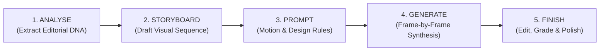

# MASTER SAAS & APP-LAUNCH MOTION WORKFLOW GUIDE
> **Source:** Motion Graphics Workflow Guide (App-Launch / SaaS Motion-Graphics Style)  
> **Core Principle:** *"The secret is not writing an enormous prompt. It is building the video in the correct sequence: Understand the reference $\rightarrow$ Design the storyboard $\rightarrow$ Instruct the model/engine on exactly how to animate those frames."*  
> **Rule of Thumb:** *"The storyboard dictates WHAT we see. The final prompt/spec dictates HOW it moves."*

---

## 1. THE FIVE-STAGE MASTER PRODUCTION LIFECYCLE



### Stage Deliverables
1. **Analyse the Reference** $\rightarrow$ **Deliverable:** `EDITORIAL DNA` (Shot order, pacing, camera movement, transitions, UI behavior, typography, ground plane, lighting).
2. **Build the Storyboard** $\rightarrow$ **Deliverable:** `VISUAL PLAN` (Defined, locked still frames for every pivotal narrative moment).
3. **Write the Final Prompt** $\rightarrow$ **Deliverable:** `VIDEO INSTRUCTIONS` (Deterministic instructions initiating motion while preserving design integrity).
4. **Generate the Video** $\rightarrow$ **Deliverable:** `RAW VIDEO SHOTS` (Short, controlled, frame-by-frame synthesized shots).
5. **Finish & Polish** $\rightarrow$ **Deliverable:** `FINAL BROADCAST MP4` (Sound mix, color grade, typographic clarity, and seamless editing).

---

## 2. STEP 1: REFERENCE ANALYSIS (THE 7 ESSENTIALS)
> [!IMPORTANT]
> **Zero Content Copying:** Never copy the subject matter, brand name, or product of a reference video; extract only the **editorial editing blueprint**.

Before generating any code or prompts, systematically extract these 7 essentials:
1. **Shot Order:** What are the first, second, third, and resolve shots?
2. **Timing:** How long does each shot linger? Where are the stillness holds and rhythmic accents?
3. **Camera Movement:** Push-in, pull-out, slide, tilt, orbit, parallax, or static?
4. **Transitions:** Snap cut, match cut, zoom-through, container morph, reveal, directional wipe, etc.
5. **Design System:** Typography, cards, UI hierarchy, iconography, padding, and corner radii.
6. **Atmosphere & Lighting:** Ground plane tone, light angle, contrast, depth, material quality, and palette.
7. **Audio Rhythm:** Which kicks, snares, or downbeats anchor visual actions and cuts?

---

## 3. STEP 2: THE NINE-SHOT SAAS & APP-LAUNCH SEQUENCE (9-SHOT FLOW)

The industry benchmark 9-shot editorial sequence for software and mobile product launches:

```
[01 App / Card] ──> [02 Store Page] ──> [03 Login / Welcome] ──> [04 AI Composer]
       │
       └──> [05 Phone Focus / 3D Tilt] ──> [06 Micro UI Move] ──> [07 Feature Matrix]
                   │
                   └──> [08 Brand End Card] ──> [09 CTA & URL Hold]
```

### 4 Mandatory Questions for Every Storyboard Frame
Every shot must explicitly answer:
- **WHAT:** Which specific object or UI component is on screen?
- **WHERE:** How is it positioned, framed, and anchored?
- **MOVE:** What animates, which direction does it travel, and what transforms?
- **WHY:** Why does this shot exist in the narrative sequence? (What value does it prove?)

### Standard Shot Template (Mini-Template for Every Shot)
In `spec.json` and `direction.md`, define each beat using this structure:

| Field | Description |
| :--- | :--- |
| **SHOT** | Shot index + exact duration (`Shot 01 • 1.2s / 72f`) |
| **VISUAL** | Exactly what the viewer sees on screen |
| **CAMERA** | Framing + momentum (`Push-in 1.0 -> 1.08, ease expo.out`) |
| **ANIMATION** | What enters, exits, scales, rotates, or glides? |
| **TEXT / UI** | Literal text copy + spatial coordinate positioning |
| **TRANSITION** | How momentum is handed off to the next beat (Peak velocity morph, whip-pan, etc.) |

---

## 4. STEP 3: SIX-BLOCK MASTER PROMPT ARCHITECTURE

Prompts directed to video models (Gemini Omni Flash, Sora, Kling, Runway) or Remotion code generators follow this 6-block structure:

```
Reference + Storyboard -> Shot Order -> Motion -> Editorial Timing -> Design Rules -> Consistency -> Restrictions -> Final Polish
```

1. **USE THE STORYBOARD:** Treat the storyboard as the single source of visual truth. Preserve shot order, composition, and visual hierarchy.
2. **MOTION:** Specify exact camera trajectory, object momentum, spring easing, velocity, and direction.
3. **EDITORIAL STYLE:** Define cutting rhythm, transition vocabulary, pacing, and reveal moments.
4. **DESIGN RULES:** Define typography, UI geometry, spacing (padding/margin), colors, materials, shadows, depth, and readability rules.
5. **CONSISTENCY:** Preserve identical product anatomy, logos, icon sets, background world, and visual identity across all shots.
6. **QUALITY CONTROL (NEGATIVE RESTRICTIONS):** No warped typography, broken interfaces, stray hallucinated objects, neon glow vomit, camera jitter, or style drift.

### Master Prompt Template (Reusable Standard)
```text
Create the final motion-graphics video from the attached storyboard.

Treat the storyboard as the source of truth for the visual sequence: keep the same shot order, composition, framing, hierarchy and overall design language.

For each shot, animate exactly what the storyboard implies. Use controlled camera movement, smooth easing, clean reveals and precise timing rather than random movement.

Preserve the editorial style: [PACING], [CUT STYLE], [TRANSITION STYLE], [TYPOGRAPHY BEHAVIOR], [UI ANIMATION BEHAVIOR] and [RHYTHM].

Preserve the design system: [BACKGROUND], [COLOR PALETTE], [TYPE STYLE], [CARD SHAPE], [SHADOWS/DEPTH], [ICON TREATMENT] and [PRODUCT/LOGO DETAILS].

Keep the product and visual identity consistent across every shot. Do not invent new UI, text, logos or objects that are not part of the storyboard.

Prioritize clean readable typography, stable geometry, accurate spacing, natural depth and polished commercial motion.

No glitches, warped letters, broken interfaces, unwanted particles, excessive bloom, random camera shake, style drift or unnecessary effects.

Output a cohesive premium motion-graphics commercial that feels like one intentionally designed piece from beginning to end.
```

---

## 5. STEP 4: VIDEO PRODUCTION DISCIPLINE (GENERATION RULES)

1. **Lock the Storyboard:** Do not modify color palettes or core geometry once synthesis/coding begins.
2. **Generate Shot by Shot:** Keep complex shots focused and modular.
3. **Check Before Moving On:** Verify the handoff frame of shot $N$ before generating shot $N+1$.
4. **Assemble the Edit:** Splice shots strictly following the storyboard sequence without arbitrary filler gaps.
5. **Final Polish:** Complete sound design (-16 LUFS), color consistency, and micro-timing adjustments in the final pass.

> [!TIP]
> - Solve the **primary motion** before layering decorative accents.
> - Keep typography bold, crisp, and stable.
> - Maintain camera movement continuity across shot boundaries (avoid abrupt reversal of momentum).
> - Explicitly declare **negative constraints**.

---

## 6. STEP 5: THE 60-SECOND FINAL QUALITY CHECKLIST

Before delivery, every video must achieve 100% sign-off across these 8 gates:

- [ ] **1. SEQUENCE:** Does the video strictly follow the storyboard order from first to final frame?
- [ ] **2. MOTION:** Is every movement intentional, smooth, and precisely timed? Are forbidden linear/easeInOut eases avoided?
- [ ] **3. DESIGN:** Do cards, UI, typography, spacing, colors, and lighting belong to a single coherent system?
- [ ] **4. TEXT:** Is all copy crisp, readable, correctly spelled, and on screen for at least 1.2 seconds?
- [ ] **5. CONSISTENCY:** Does the product geometry and brand identity remain stable from shot to shot?
- [ ] **6. TRANSITIONS:** Do transitions feel like a continuous editorial river rather than disconnected clips?
- [ ] **7. CLEAN FRAME:** Is the composition free of neon glow, blurring artifacts, and broken UI mockups?
- [ ] **8. ENDING:** Does the final brand / logo / CTA hold crystal clear for at least 1.2 seconds (72 frames)?
