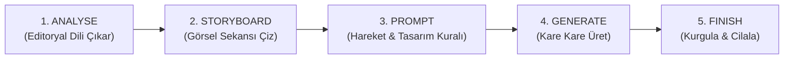

# MASTER SAAS & APP-LAUNCH MOTION WORKFLOW GUIDE
> **Kaynak:** Motion Graphics Workflow Guide (App-Launch / SaaS Motion-Graphics Style)  
> **Temel İlke:** *"İşin sırrı devasa bir prompt yazmak değildir. Videoyu doğru sırada inşa etmektir: Referansı anla $\rightarrow$ Storyboard tasarla $\rightarrow$ Modele bu kareleri tam olarak nasıl canlandıracağını söyle."*  
> **Altın Kural (Rule of Thumb):** *"Storyboard NEYİ (WHAT) gördüğümüzü belirler. Final prompt ise NASIL (HOW) hareket ettiğini belirler."*

---

## 1. BEŞ AŞAMALI MASTER ÜRETİM DÖNGÜSÜ



### Aşama Çıktıları (Strict Deliverables)
1. **Analyse the Reference** $\rightarrow$ **Çıktı:** `EDITORIAL DNA` (Çekim sırası, tempo, kamera hareketleri, geçişler, UI davranışı, tipografi, zemin, ışık).
2. **Build the Storyboard** $\rightarrow$ **Çıktı:** `VISUAL PLAN` (Her önemli an için tanımlı ve kilitlenmiş durağan kare).
3. **Write the Final Prompt** $\rightarrow$ **Çıktı:** `VIDEO INSTRUCTIONS` (Tasarımı ve sekansı koruyarak hareketi başlatan deterministik komutlar).
4. **Generate the Video** $\rightarrow$ **Çıktı:** `RAW VIDEO SHOTS` (Kısa, kontrollü, kare kare üretilmiş çekimler).
5. **Finish & Polish** $\rightarrow$ **Çıktı:** `FINAL BROADCAST MP4` (Ses miksi, renk rötuşu, metin netliği ve pürüzsüz kurgu).

---

## 2. ADIM 1: REFERANS ANALİZİ (THE 7 ESSENTIALS)
> [!IMPORTANT]
> **Sıfır İçerik Kopyalama:** Referans videonun konusunu, şirket adını veya ürününü asla kopyalamazsınız; yalnızca **kurgu şablonunu (editing blueprint)** çıkarırsınız.

Bir referans incelenirken şu 7 öğe eksiksiz listelenmeden asla kod veya prompt yazılamaz:
1. **Shot Order (Çekim Sırası):** İlk, ikinci, üçüncü çekim ne? Final çekimi ne?
2. **Timing (Zamanlama):** Her çekim ne kadar hissettiriyor? Duraklamalar (stillness) ve vurgular (accents) nerede?
3. **Camera (Kamera Hareketi):** Push-in, pull-out, slide, tilt, orbit, paralaks veya statik mi?
4. **Transitions (Geçişler):** Snap cut, match cut, zoom-through, morph, reveal, blur vb.
5. **Design (Tasarım Sistemi):** Tipografi, kartlar, UI hiyerarşisi, ikonlar, spacing (boşluklar), köşe yuvarlatmaları (radius).
6. **Look (Görsel Atmosfer):** Arka plan rengi, ışık açısı, kontrast, derinlik, malzeme ve renk paleti.
7. **Audio Rhythm (Ses Senkronu):** Hareketler veya kesmeler müziğin hangi vuruşuna (kick, snare, downbeat) kilitli?

---

## 3. ADIM 2: DOKUZLU SAAS & APP-LAUNCH MASTER SEKANSI (9-SHOT FLOW)

SaaS ve mobil ürün lansmanları için altın standart kabul edilen 9 çekimlik editoryal sekans:

```
[01 App / Card] ──> [02 Store Page] ──> [03 Login / Welcome] ──> [04 AI Composer]
       │
       └──> [05 Phone Focus / 3D Tilt] ──> [06 Micro UI Move] ──> [07 Feature Matrix]
                   │
                   └──> [08 Brand End Card] ──> [09 CTA & URL Hold]
```

### Her Storyboard Karesi İçin 4 Zorunlu Soru
Her kare şu 4 soruya kesin cevap vermelidir:
- **WHAT:** Ekranda hangi nesne veya UI bileşeni var?
- **WHERE:** Nerede konumlandırılmış ve nasıl kadrajlanmış?
- **MOVE:** Ne hareket etmeli, ne yöne akmalı veya ne değişmeli?
- **WHY:** Bu çekim anlatı kurgusunda neden var? (Neyi kanıtlıyor?)

### Standart Çekim Şablonu (Mini-Template For Every Shot)
`spec.json` veya `direction.md` içindeki her çekim/beat için şu format kullanılır:

| Alan | Açıklama |
| :--- | :--- |
| **SHOT** | Çekim numarası + yaklaşık süre (`Shot 01 • 1.2s / 72f`) |
| **VISUAL** | İzleyicinin ekranda tam olarak ne gördüğü |
| **CAMERA** | Kadraj boyutu + hareket yönü (ör: `Push-in 1.0 -> 1.08, ease expo.out`) |
| **ANIMATION** | Ne giriyor, çıkıyor, büyüyor, dönüyor veya kayıyor? |
| **TEXT / UI** | Ekranda yer alacak birebir metin + yerleşim konumu |
| **TRANSITION** | Bu çekimin bir sonrakine nasıl devredildiği (Peak velocity morph, whip-pan vb.) |

---

## 4. ADIM 3: ALTI BLOKLU MASTER PROMPT MİMARİSİ

Doğrudan video AI modellerine (Gemini Omni Flash, Sora, Kling, Runway) veya Remotion motoruna verilecek prompt 6 kısa bloktan inşa edilir:

```
Reference + Storyboard -> Shot Order -> Motion -> Editorial Timing -> Design Rules -> Consistency -> Restrictions -> Final Polish
```

1. **USE THE STORYBOARD:** Yüklenen storyboard'u tek görsel gerçeklik kaynağı kabul et. Çekim sırasını, kompozisyonu ve hiyerarşiyi koru.
2. **MOTION:** Kesin kamera hareketi, nesne hareketi, yay fiziği (easing), hız ve yönü açıkça belirt.
3. **EDITORIAL STYLE:** Kesme mantığı, geçiş dili, tempo, ritim ve ortaya çıkış (reveal) anlarını tanımla.
4. **DESIGN RULES:** Tipografi, UI geometrisi, boşluklar (padding/margin), renkler, malzemeler, gölgeler, derinlik ve okunabilirlik kuralları.
5. **CONSISTENCY:** Tüm çekimler boyunca aynı ürün, aynı logo, aynı ikon stili, aynı arka plan dünyası ve görsel sistem.
6. **QUALITY CONTROL (NEGATİF KISITLAMALAR):** Bozuk/yamuk metin yok, kırık UI yok, rastgele beliren yabancı nesneler yok, neon parlama yok, kamera titremesi yok, stil kayması yok.

### Master Prompt Şablonu (Kopyalanabilir Standart)
```text
Create the final motion-graphics video from the attached storyboard.

Treat the storyboard as the source of truth for the visual sequence: keep the same shot order, composition, framing, hierarchy and overall design language.

For each shot, animate exactly what the storyboard implies. Use controlled camera movement, smooth easing, clean reveals and precise timing rather than random movement.

Preserve the editorial style: [PACING], [CUT STYLE], [TRANSITION STYLE], [TYPOGRAPHY BEHAVIOR], [UI ANIMATION BEHAVIOR] and [RHYTHM].

Preserve the design system: [BACKGROUND], [COLOR PALETTE], [TYPE STYLE], [CARD SHAPE], [SHADOWS/DEPTH], [ICON TREATMENT] and [PRODUCT/LOGO DETAILS].

Keep the product and visual identity consistent across every shot. Do not invent new UI, text, logos or objects that are not part of the storyboard.

Prioritize clean readable typography, stable geometry, accurate spacing, natural depth and polished commercial motion.

No glitches, warped letters, broken interfaces, unwanted particles, excessive bloom, random camera shake, style drift or unnecessary effects.

Output a cohesive premium motion-graphics commercial that feels like one intentionally designed piece from beginning to end.
```

---

## 5. ADIM 4: VİDEO ÜRETİM DİSİPLİNİ (GENERATION RULES)

1. **Lock the Storyboard:** Üretim / kodlama başladıktan sonra tasarımı ve renkleri sürekli değiştirmeyin.
2. **Generate Shot by Shot:** Önemli ve karmaşık çekimleri kısa ve odaklı tutun.
3. **Check Before Moving On:** Bir önceki çekimin son karesini (handoff frame) doğrulamadan sonraki çekimi başlatmayın.
4. **Assemble the Edit:** Çekimleri tam storyboard sırasıyla birleştirin; araya plansız boşluk koymayın.
5. **Final Polish:** Ses efektleri (-16 LUFS), renk uyumu ve mikro-zamanlama rötuşlarını en son tamamlayın.

> [!TIP]
> - Süslü efektler eklemeden önce **ana hareketi** çözün.
> - Tipografiyi büyük, net ve stabil tutun.
> - Ardışık çekimler arasında kamera hareket yönünü tutarlı kılın (ör. sola kayıyorsa sonraki çekimde aniden zıt yöne savrulmasın).
> - İstekleri belirtirken **negatif kısıtlamaları (restrictions)** açıkça yazın.

---

## 6. ADIM 5: 60 SANİYELİK NİHAİ KALİTE KONTROL LİSTESİ (THE 60-SECOND CHECKLIST)

Video teslim edilmeden önce bu 8 kapıdan %100 onay almak zorundadır:

- [ ] **1. SEQUENCE (Sıralama):** Nihai video ilk kareden son kareye storyboard sırasını eksiksiz takip ediyor mu?
- [ ] **2. MOTION (Hareket Fiziği):** Her hareket kasıtlı, pürüzsüz ve doğru zamanlanmış mı? Yasaklı linear/easeInOut var mı?
- [ ] **3. DESIGN (Tasarım Bütünlüğü):** Kartlar, UI, font, boşluklar, renkler ve ışıklandırma tek bir stüdyo sistemine mi ait?
- [ ] **4. TEXT (Okunabilirlik):** Tüm önemli metinler okunabilir, doğru yazılmış ve en az 1.2 saniye ekranda kalıyor mu?
- [ ] **5. CONSISTENCY (Tutarlılık):** Ürün ve logo çekimden çekime şekil ve renk değiştiriyor mu?
- [ ] **6. TRANSITIONS (Geçiş Ritim):** Geçişler bağımsız video klipleri gibi değil, akıcı tek bir editoryal nehir gibi hissettiriyor mu?
- [ ] **7. CLEAN FRAME (Görsel Saflık):** İstenmeyen neon glow, bulanıklık, yapay nesneler veya bozuk UI öğeleri var mı?
- [ ] **8. ENDING (Kapanış Vurgusu):** Son marka / logo / URL karesi izleyicinin rahatça okuyup sindirebileceği kadar (en az 72f) ekranda asılı kalıyor mu?
